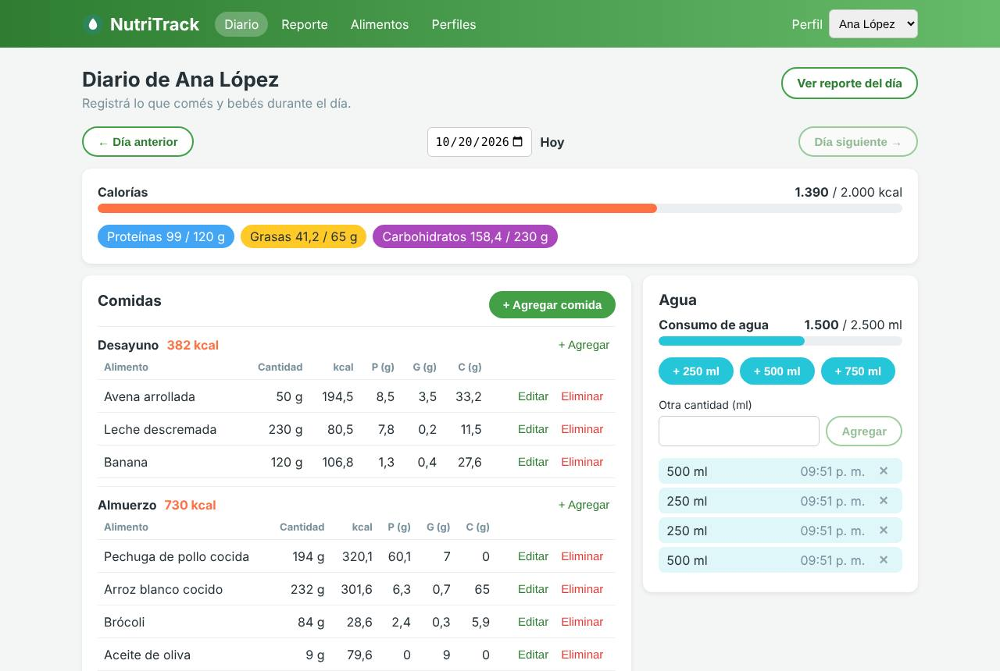
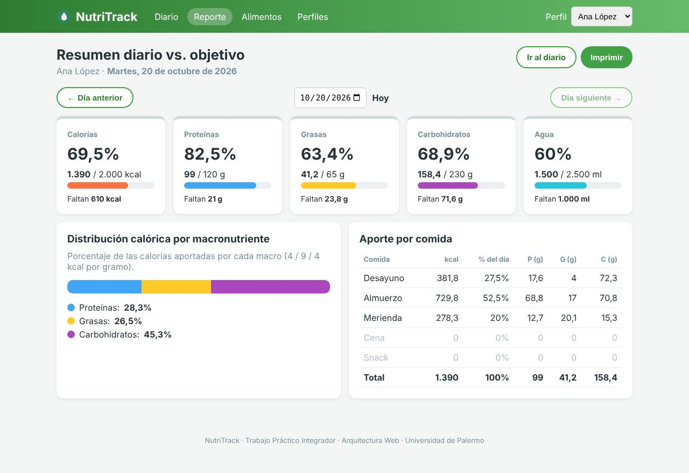

<section class="caratula">

<p class="caratula__institucion">Universidad de Palermo</p>
<p class="caratula__materia">Arquitectura Web</p>

<h1 class="caratula__titulo">NutriTrack</h1>
<p class="caratula__subtitulo">Registro diario de alimentos, macronutrientes y consumo de agua</p>

<p class="caratula__tipo">Trabajo Práctico Integrador</p>

<table class="caratula__datos">
<tr><th>Alumno</th><td>Máximo Barros</td></tr>
<tr><th>Legajo</th><td>0139600</td></tr>
<tr><th>Modalidad</th><td>Individual</td></tr>
<tr><th>Fecha</th><td>Octubre de 2026</td></tr>
</table>

</section>

# 1. Descripción de la aplicación

**NutriTrack** es una aplicación web para llevar un registro diario de la alimentación. Cada persona tiene un **perfil** con sus objetivos diarios de calorías, proteínas, grasas, carbohidratos y agua. Durante el día registra lo que come eligiendo un alimento de un **catálogo** e indicando los gramos; la aplicación calcula automáticamente los macronutrientes de cada registro. También registra los vasos de agua que toma. Un **reporte diario** muestra cuánto consumió frente a sus objetivos.

## 1.1 Funcionalidades

| Pantalla | Funcionalidad |
| --- | --- |
| **Diario** | Registro de comidas del día agrupadas en desayuno, almuerzo, merienda, cena y snack (alta, edición y baja). Vista previa de los macros antes de guardar. Registro rápido de agua (+250/+500/+750 ml o cantidad libre) y baja de registros. Navegación entre días. |
| **Reporte** | Resumen diario vs. objetivo: porcentaje alcanzado y cantidad restante (o excedida) de calorías, proteínas, grasas, carbohidratos y agua; distribución calórica por macronutriente; aporte de cada comida del día. Imprimible. |
| **Alimentos** | ABM completo del catálogo de alimentos (valores cada 100 g) con búsqueda por nombre y filtro por categoría. |
| **Perfiles** | ABM de perfiles con sus objetivos diarios y selección del perfil activo. |

Con esto se cubren los requisitos del enunciado: **tres ABM** (alimentos, perfiles y registros de comida) y **una pantalla de reporte**.





## 1.2 Alcance

**Incluido**

- Múltiples perfiles, cada uno con sus objetivos y sus propios registros. El perfil activo se elige desde la cabecera y el navegador lo recuerda.
- Catálogo de alimentos compartido entre perfiles, con valores nutricionales cada 100 g.
- Registro de comidas por fecha y tipo de comida, con cálculo de calorías y macros en el backend.
- Registro de consumo de agua por fecha.
- Reporte diario contra los objetivos del perfil.
- Validación de datos en el backend con mensajes de error por campo, mostrados en los formularios.
- Datos de ejemplo cargados automáticamente al iniciar (25 alimentos, 2 perfiles y 7 días de registros).
- Interfaz responsive (escritorio y celular) y accesible (HTML semántico, etiquetas en formularios, navegación con teclado).

**Fuera de alcance**

- Autenticación y autorización (el enunciado la marca como opcional). Los perfiles no tienen contraseña: cualquiera que acceda a la aplicación puede ver y editar todos los perfiles. Para un uso real habría que agregar login y asociar cada perfil a un usuario autenticado.
- Integración con bases nutricionales externas o lectura de códigos de barras: los alimentos se cargan a mano.
- Reportes de períodos largos (semanal o mensual) y gráficos de evolución. La API ya permite consultar registros por rango de fechas (`desde`/`hasta`), así que se pueden agregar después sin cambiar el modelo.
- Recetas o comidas compuestas por varios alimentos.
- Despliegue en la nube: la aplicación está pensada para ejecutarse en forma local.

# 2. Arquitectura y justificación de las decisiones

## 2.1 Visión general

La aplicación sigue una arquitectura **cliente-servidor** con una **SPA** (Single Page Application) que consume una **API REST**. El frontend se encarga sólo de la presentación. Toda la lógica de negocio (cálculo de macros, totales del reporte, reglas de integridad) está en el backend, como pide el enunciado.

```
┌──────────────────────┐   HTTP + JSON    ┌──────────────────────────────────────────────┐
│  Navegador           │  /api/...        │  Node.js + Express                           │
│  React (SPA)         │ ───────────────► │  routes → controllers → services → repos     │
│  pages / components  │ ◄─────────────── │        ▲ validators (Zod)   │                │
│  api/client.js       │   status codes   │        middlewares          ▼                │
└──────────────────────┘                  │                       SQLite (archivo)       │
                                          └──────────────────────────────────────────────┘
```

En producción **un único proceso Express** entrega el frontend compilado y atiende la API en el mismo origen, así que no hace falta configurar CORS. En desarrollo, Vite levanta su propio servidor con recarga en caliente y redirige (*proxy*) las rutas `/api` al backend.

## 2.2 Backend en capas

El backend separa responsabilidades en capas. Cada capa sólo conoce a la siguiente:

| Capa | Responsabilidad | Ejemplo |
| --- | --- | --- |
| **Rutas** (`routes/`) | Declaran los recursos, qué verbos HTTP aceptan y qué validaciones aplican. Responden `405` a los verbos no soportados. | `recurso(router, '/:id', { get, put, delete })` |
| **Validadores** (`validators/`) | Esquemas Zod para `params`, `query` y `body`. Convierten tipos y generan errores por campo. | `comidaBody`, `filtroFechas` |
| **Controladores** (`controllers/`) | Traducen entre HTTP y los servicios: leen la petición validada y eligen status code y headers (`201` + `Location`, `204`). | `crear → res.status(201).location(...)` |
| **Servicios** (`services/`) | Reglas de negocio: existencia de recursos (404), conflictos (409), referencias inválidas (422), cálculo del reporte. | `reportesService.resumenDiario()` |
| **Repositorios** (`repositories/`) | Acceso a datos con SQL parametrizado. No conocen HTTP. | `comidasRepository.listar()` |
| **Middlewares** | Validación genérica y manejo centralizado de errores con un formato de respuesta único. | `errorHandler` |

Las dependencias se arman en `app.js` con funciones fábrica (`createXxxService({ repositorio })`), que reciben la conexión a la base por parámetro. Esto permite que **los tests usen una base en memoria distinta** para cada caso sin modificar el código, y deja cada capa fácil de reemplazar (por ejemplo, cambiar SQLite por PostgreSQL sólo afectaría a los repositorios).

## 2.3 Tecnologías elegidas

| Decisión | Alternativas consideradas | Justificación |
| --- | --- | --- |
| **Node.js + Express 5** | Fastify, NestJS | El enunciado exige Node.js y recomienda Express. Express 5 propaga automáticamente los errores de los handlers al middleware de errores y tiene un ecosistema muy maduro. NestJS agregaba una complejidad que no se justifica para este tamaño de proyecto. |
| **SQLite** (`better-sqlite3`) | Persistencia en memoria, MongoDB, PostgreSQL | Es una base relacional real (claves foráneas, `CHECK`, `UNIQUE`, borrado en cascada, índices) que **no requiere instalar ni levantar un servidor**: es un archivo. Así quien corrige puede ejecutar el proyecto sólo con `npm install`. A diferencia de la persistencia en memoria, los datos sobreviven a los reinicios. El modelo es naturalmente relacional (usuarios → registros ← alimentos), por eso se descartó una base documental. `better-sqlite3` tiene una API síncrona y rápida, ideal para un servidor de un solo proceso. |
| **SQL directo** en repositorios | ORM (Sequelize, Prisma) | El modelo tiene cuatro tablas y las consultas son simples. Escribir SQL parametrizado deja ver exactamente qué se ejecuta (por ejemplo, el cálculo de macros en el `SELECT`), evita la "magia" de un ORM y protege contra inyección SQL con *prepared statements*. |
| **Zod** para validación | express-validator, Joi, validación manual | Esquemas declarativos y reutilizables que validan y además **convierten** tipos (por ejemplo, el `id` de la URL a número). Con `.strict()` se rechazan campos desconocidos. |
| **Helmet** y **Morgan** | — | Helmet agrega headers de seguridad (CSP, `X-Content-Type-Options`, etc.) y oculta `X-Powered-By`. Morgan registra cada petición en consola, útil durante el desarrollo. |
| **React 18 + Vite** | Vanilla JS, Vue, Angular | React permite componer la interfaz en componentes reutilizables (formularios, modal, barras de progreso) y manejar el estado de forma declarativa. Vite ofrece arranque instantáneo en desarrollo y un build optimizado. Angular resultaba excesivo para el tamaño del proyecto. |
| **React Router** | Navegación manual | Cada pantalla tiene su propia URL. La fecha seleccionada también viaja en la URL (`/reporte?fecha=2026-10-15`), así se puede compartir un enlace o usar los botones atrás/adelante del navegador. |
| **CSS propio** | Bootstrap, Tailwind | El enunciado evalúa el uso correcto de HTML y CSS. Una hoja propia y simple, con Grid/Flexbox, variables para los colores de cada macro, *media queries* para móvil y estilos de impresión, muestra ese manejo sin depender de clases de terceros. |
| **Jest + Supertest** | Postman/Newman, `node:test` | Los tests quedan codificados y versionados junto al código y se ejecutan con `npm test`. Supertest hace peticiones HTTP reales contra la app sin abrir un puerto. |
| **npm workspaces** | Dos proyectos separados | Un solo `npm install` y scripts unificados en la raíz (`dev`, `build`, `start`, `test`) para backend y frontend. |

## 2.4 Diseño de la API REST

La API alcanza el **nivel 2 del modelo de madurez de Richardson**:

- **Recursos identificados por URL**, con sustantivos en plural: `/alimentos`, `/usuarios`. Los registros diarios son **sub-recursos del usuario** al que pertenecen (`/usuarios/1/comidas/15`): la URL expresa la relación, y un usuario no puede leer ni modificar registros de otro (se responde `404`).
- **Verbos HTTP con su semántica**: `GET` lee (seguro e idempotente), `POST` crea, `PUT` reemplaza el recurso completo (idempotente) y `DELETE` elimina.
- **Códigos de estado** adecuados a cada caso:

| Código | Cuándo se usa |
| --- | --- |
| `200 OK` | Lecturas y actualizaciones exitosas |
| `201 Created` | Creación; incluye el header **`Location`** con la URL del nuevo recurso |
| `204 No Content` | Eliminación exitosa / respuesta a `OPTIONS` |
| `400 Bad Request` | Datos inválidos (con detalle por campo), JSON mal formado o campos desconocidos |
| `404 Not Found` | El recurso (o el usuario dueño del sub-recurso) no existe |
| `405 Method Not Allowed` | Verbo no soportado en ese recurso; incluye el header **`Allow`** |
| `409 Conflict` | Nombre de alimento o email duplicado; eliminar un alimento que se usa en registros |
| `422 Unprocessable Content` | La petición está bien formada pero referencia un alimento inexistente |
| `500 Internal Server Error` | Error no previsto (se registra en el servidor sin exponer detalles) |

- **Filtros como query string** sobre las colecciones (`?fecha=`, `?desde=&hasta=`, `?q=`, `?categoria=`).
- **El reporte también es un recurso** (`/usuarios/:id/reportes/resumen-diario`): es de sólo lectura y se calcula a partir de los registros.
- **Formato de error único** en toda la API:

```json
{
  "error": {
    "status": 400,
    "mensaje": "Los datos enviados no son válidos",
    "detalles": [
      { "campo": "body.gramos", "mensaje": "Debe ser mayor a 0" }
    ]
  }
}
```

El frontend usa `detalles` para mostrar cada mensaje debajo del campo correspondiente del formulario.

## 2.5 Modelo de datos

```
usuarios (id, nombre, email UNIQUE, objetivo_calorias, objetivo_proteinas,
          objetivo_grasas, objetivo_carbohidratos, objetivo_agua_ml, creado_en)
alimentos (id, nombre UNIQUE, categoria, calorias, proteinas, grasas, carbohidratos)   -- cada 100 g
registros_comida (id, usuario_id → usuarios ON DELETE CASCADE,
                  alimento_id → alimentos ON DELETE RESTRICT,
                  fecha, tipo_comida, gramos, creado_en)
registros_agua (id, usuario_id → usuarios ON DELETE CASCADE, fecha, cantidad_ml, creado_en)
```

Decisiones del modelo:

- Los registros de comida **no guardan los macros calculados**: se calculan en la consulta (`alimento.calorias * gramos / 100`). Así hay una sola fuente de verdad y, si se corrige un valor del catálogo, los registros quedan consistentes.
- Eliminar un perfil borra en cascada sus registros. Eliminar un alimento que se usa en registros se **impide** (`409 Conflict`) para no perder historial.
- Las restricciones `CHECK` en la base (gramos > 0, tipo de comida válido, etc.) son una segunda barrera además de la validación de la API.
- Índices por `(usuario_id, fecha)`, que es la consulta más frecuente (el diario y el reporte de un día).

## 2.6 Frontend

- **Páginas** (`pages/`): Diario, Reporte, Alimentos, Perfiles y una página 404.
- **Componentes reutilizables**: `Modal` (basado en el elemento nativo `<dialog>`, accesible y con cierre por Escape), `Campo` (asocia etiqueta, control y mensaje de error con `aria-describedby`), `BarraProgreso` (con `role="progressbar"`), `NavegadorFecha`, formularios.
- **Cliente de la API** (`api/client.js`): centraliza `fetch`, el armado de query strings y la conversión de las respuestas de error en una excepción `ApiError` con los errores por campo.
- **Estado**: un *Context* para el perfil activo (guardado en `localStorage`) y hooks propios: `useCarga` (carga asíncrona que descarta respuestas viejas), `useFormulario` y `useFechaEnUrl`.
- **HTML semántico**: `header`, `nav`, `main`, `section`, `article`, `footer`; tablas con `thead`/`tbody`/`tfoot`, `scope` y `caption`; listas de definición (`dl`) para pares dato-valor; `fieldset`/`legend` para agrupar campos; `optgroup` para agrupar alimentos por categoría; enlace "Saltar al contenido".
- **CSS**: hoja única y simple con Grid y Flexbox, variables para los colores de cada macro, diseño responsive con *media queries* (probado a 390 px de ancho sin scroll horizontal) y hoja de impresión para el reporte.

## 2.7 Seguridad

- Consultas SQL siempre parametrizadas (incluida la búsqueda con `LIKE`, donde además se escapan los comodines `%` y `_`).
- Validación estricta de toda entrada: tipos, rangos, formato de fecha real del calendario y rechazo de campos no esperados.
- Límite de tamaño del cuerpo de las peticiones (100 kB).
- Headers de seguridad con Helmet, incluida una política CSP.
- Los errores internos no exponen detalles ni *stack traces* al cliente.

# 3. Endpoints del backend

Base URL: `http://localhost:3000/api`. Todos los cuerpos de petición y respuesta son JSON.

## 3.1 General

| Endpoint | Verbo | Descripción | Respuestas |
| --- | --- | --- | --- |
| `/api/health` | GET | Verifica que el servicio esté funcionando. | 200 |

## 3.2 Alimentos

| Endpoint | Verbo | Descripción | Respuestas |
| --- | --- | --- | --- |
| `/api/alimentos` | GET | Lista el catálogo ordenado por nombre. Filtros opcionales: `q` (texto contenido en el nombre) y `categoria`. | 200, 400 |
| `/api/alimentos` | POST | Crea un alimento. Body: `nombre`, `categoria`, `calorias`, `proteinas`, `grasas`, `carbohidratos` (cada 100 g; la suma de macros no puede superar 100 g). | 201, 400, 409 |
| `/api/alimentos/categorias` | GET | Lista las categorías existentes, sin repetir. | 200 |
| `/api/alimentos/{id}` | GET | Obtiene un alimento. | 200, 400, 404 |
| `/api/alimentos/{id}` | PUT | Reemplaza todos los datos de un alimento. | 200, 400, 404, 409 |
| `/api/alimentos/{id}` | DELETE | Elimina un alimento. Si se usa en algún registro de comida responde 409. | 204, 404, 409 |

## 3.3 Usuarios (perfiles)

| Endpoint | Verbo | Descripción | Respuestas |
| --- | --- | --- | --- |
| `/api/usuarios` | GET | Lista los perfiles con sus objetivos. | 200 |
| `/api/usuarios` | POST | Crea un perfil. Body: `nombre`, `email`, `objetivoCalorias`, `objetivoProteinas`, `objetivoGrasas`, `objetivoCarbohidratos`, `objetivoAguaMl`. | 201, 400, 409 |
| `/api/usuarios/{id}` | GET | Obtiene un perfil. | 200, 400, 404 |
| `/api/usuarios/{id}` | PUT | Reemplaza los datos y objetivos de un perfil. | 200, 400, 404, 409 |
| `/api/usuarios/{id}` | DELETE | Elimina el perfil y, en cascada, todos sus registros de comida y agua. | 204, 404 |

## 3.4 Registros de comida

| Endpoint | Verbo | Descripción | Respuestas |
| --- | --- | --- | --- |
| `/api/usuarios/{usuarioId}/comidas` | GET | Lista los registros del usuario con calorías y macros calculados. Filtros: `fecha` **o** rango `desde`/`hasta`, y `tipoComida`. Ordenados por fecha y tipo de comida. | 200, 400, 404 |
| `/api/usuarios/{usuarioId}/comidas` | POST | Registra una comida. Body: `alimentoId`, `fecha` (YYYY-MM-DD), `tipoComida` (`desayuno`, `almuerzo`, `merienda`, `cena`, `snack`), `gramos`. | 201, 400, 404, 422 |
| `/api/usuarios/{usuarioId}/comidas/{id}` | GET | Obtiene un registro de comida del usuario. | 200, 400, 404 |
| `/api/usuarios/{usuarioId}/comidas/{id}` | PUT | Modifica un registro (alimento, fecha, tipo y gramos). | 200, 400, 404, 422 |
| `/api/usuarios/{usuarioId}/comidas/{id}` | DELETE | Elimina un registro de comida. | 204, 404 |

## 3.5 Registros de agua

| Endpoint | Verbo | Descripción | Respuestas |
| --- | --- | --- | --- |
| `/api/usuarios/{usuarioId}/agua` | GET | Lista los registros de agua del usuario. Filtros: `fecha` o rango `desde`/`hasta`. | 200, 400, 404 |
| `/api/usuarios/{usuarioId}/agua` | POST | Registra un consumo de agua. Body: `fecha`, `cantidadMl` (entero, 1 a 5000). | 201, 400, 404 |
| `/api/usuarios/{usuarioId}/agua/{id}` | GET | Obtiene un registro de agua. | 200, 400, 404 |
| `/api/usuarios/{usuarioId}/agua/{id}` | PUT | Modifica fecha y cantidad de un registro. | 200, 400, 404 |
| `/api/usuarios/{usuarioId}/agua/{id}` | DELETE | Elimina un registro de agua. | 204, 404 |

## 3.6 Reportes

| Endpoint | Verbo | Descripción | Respuestas |
| --- | --- | --- | --- |
| `/api/usuarios/{usuarioId}/reportes/resumen-diario` | GET | Resumen del día indicado en `fecha` (por defecto, hoy): totales consumidos, objetivos, porcentaje alcanzado, restante (negativo si se excedió), distribución calórica por macronutriente y desglose por tipo de comida. | 200, 400, 404 |

Ejemplo de respuesta (resumida):

```json
{
  "usuario": { "id": 1, "nombre": "Ana López" },
  "fecha": "2026-10-17",
  "consumido":  { "calorias": 1390, "proteinas": 99, "grasas": 41.2, "carbohidratos": 158.4, "aguaMl": 1500 },
  "objetivo":   { "calorias": 2000, "proteinas": 120, "grasas": 65, "carbohidratos": 230, "aguaMl": 2500 },
  "porcentaje": { "calorias": 69.5, "proteinas": 82.5, "grasas": 63.4, "carbohidratos": 68.9, "aguaMl": 60 },
  "restante":   { "calorias": 610, "proteinas": 21, "grasas": 23.8, "carbohidratos": 71.6, "aguaMl": 1000 },
  "distribucionCalorica": { "proteinas": 28.3, "grasas": 26.5, "carbohidratos": 45.3 },
  "porTipoComida": [
    { "tipoComida": "desayuno", "cantidadRegistros": 3, "calorias": 381.8, "porcentajeCalorias": 27.5, "...": "..." }
  ],
  "cantidadRegistros": { "comidas": 9, "agua": 4 }
}
```

Además, todos los recursos responden a `OPTIONS` con el header `Allow` (`204`), y a cualquier otro verbo no soportado con `405`.

# 4. Testing

Los endpoints se prueban con **Jest + Supertest** (`backend/tests/`). En cada test se crea una base SQLite **en memoria** cargada con los mismos datos de ejemplo que usa la aplicación, de modo que los casos no dependen entre sí ni del estado de la base local.

| Suite | Qué verifica |
| --- | --- |
| `alimentos.test.js` | Listado y filtros (incluido el escape de comodines), alta con `201` + `Location`, errores de validación por campo, JSON mal formado, campos desconocidos, nombre duplicado (`409`), actualización, baja y bloqueo de baja si el alimento está en uso, `405` con header `Allow`. |
| `usuarios.test.js` | ABM de perfiles, normalización del email, email duplicado, borrado en cascada de sus registros (verificado en la base). |
| `comidas.test.js` | Filtros por fecha, rango y tipo; orden; cálculo de macros según los gramos; `422` por alimento inexistente; aislamiento entre usuarios; edición y baja. |
| `agua.test.js` | ABM de registros de agua y validaciones (cantidad entera y positiva, fecha obligatoria). |
| `reportes.test.js` | Fecha por defecto, totales iguales a la suma de los registros, porcentajes y restantes, desglose por comida, día sin registros, impacto de un registro nuevo y exceso del objetivo. |
| `general.test.js` | Health check, `404` en JSON, `OPTIONS`, headers de seguridad. |

Resultado: **62 tests, todos aprobados**. Cobertura del código del backend: 96 % de sentencias y 98 % de funciones (`npm run test:coverage`).

# 5. Build y ejecución

Requisito: Node.js 20 o superior. Los pasos completos están en el `README.md`.

```bash
npm install        # dependencias de backend y frontend
npm test           # tests de la API
npm run build      # build del frontend
npm start          # http://localhost:3000
```

Para desarrollo: `npm run dev` (frontend en `http://localhost:5173` con recarga en caliente). Para volver a los datos iniciales: `npm run db:reset`. Para generar el `.zip` de entrega sin dependencias ni binarios: `npm run zip`.

# 6. Fuentes y uso de herramientas

**Herramientas de inteligencia artificial.** Para el desarrollo se usó **Claude Code** (Anthropic), un asistente de programación basado en IA generativa. Se utilizó para:

- Relevar los requisitos y elegir el stack y el alcance a partir de preguntas sobre las preferencias del proyecto (frontend, persistencia, login, modelo de registro de comidas, reportes, herramienta de testing).
- Generar la estructura inicial del backend en capas, los componentes del frontend, los tests y el borrador de esta documentación.
- Revisar la interfaz con capturas automatizadas (Playwright) y corregir problemas detectados, como el desborde horizontal en pantallas de celular y los mensajes de validación con errores de concordancia.

Todo el código generado se revisó, se ejecutó y se adaptó a los requisitos específicos de este trabajo. La suite de tests verifica el comportamiento de cada endpoint. Las decisiones de diseño descriptas en la sección 2 se tomaron evaluando las alternativas indicadas.

**Documentación de referencia**

- Express 5 — <https://expressjs.com/>
- React — <https://react.dev/> · React Router — <https://reactrouter.com/> · Vite — <https://vite.dev/>
- better-sqlite3 — <https://github.com/WiseLibs/better-sqlite3> · SQLite — <https://www.sqlite.org/docs.html>
- Zod — <https://zod.dev/> · Helmet — <https://helmetjs.github.io/>
- Jest — <https://jestjs.io/> · Supertest — <https://github.com/ladjs/supertest>
- MDN Web Docs (HTML, CSS, HTTP, `<dialog>`, ARIA) — <https://developer.mozilla.org/>
- M. Fowler, *Richardson Maturity Model* — <https://martinfowler.com/articles/richardsonMaturityModel.html>
- RFC 9110, *HTTP Semantics* (códigos de estado y headers `Location` / `Allow`) — <https://www.rfc-editor.org/rfc/rfc9110>

**Datos nutricionales.** Los valores de los alimentos de ejemplo son aproximados, tomados de USDA FoodData Central (<https://fdc.nal.usda.gov/>), y se usan sólo como datos de prueba.

**Factores de conversión.** La distribución calórica usa los factores de Atwater (4 kcal/g para proteínas y carbohidratos, 9 kcal/g para grasas).
